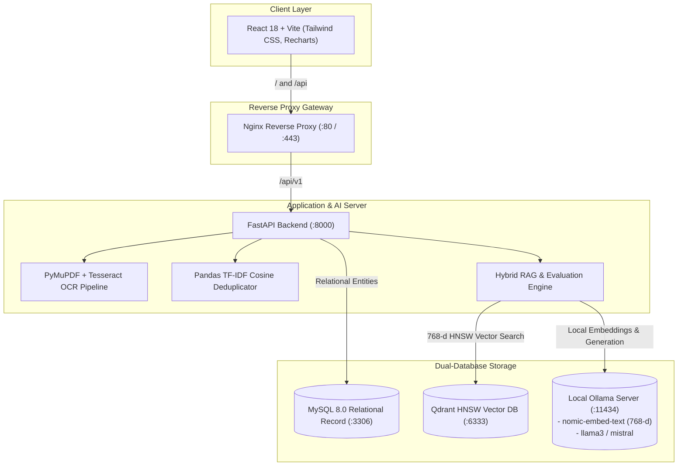

# Placyra — AI-Powered Campus Placement & Career Preparation Assistant

[](https://fastapi.tiangolo.com)
[](https://react.dev)
[](https://www.mysql.com)
[](https://qdrant.tech)
[](https://ollama.ai)
[](https://tailwindcss.com)

**Placyra** is a complete, production-grade, AI-powered monorepo engineered to streamline university campus recruitment, career preparation, and training & placement (T&P) cell operations. 

Placyra bridges the gap between student competencies and employer job descriptions (JDs) through **OCR resume parsing**, **TF-IDF cosine question deduplication**, **Qdrant HNSW semantic vector search**, and **local adaptive RAG mock interviews** powered by Ollama.

---

## 🏛️ System Architecture



---

## 🚀 Key Features

1. **Dual-Database System of Record & Semantic Retrieval**:
   - **MySQL 8.0**: Stores relational entities, users, companies, JDs, interview transcripts, and moderation states.
   - **Qdrant Vector Database**: HNSW-indexed collections (`company_questions` and `student_resumes`) with 768-dimensional Cosine metrics.
2. **Local AI Privacy-First Execution (Ollama)**:
   - High-density vector embeddings via `nomic-embed-text`.
   - Real-time conversational interview turns and constructive evaluation via `llama3` (or `mistral`).
   - Graceful fallback: Built-in deterministic 768-d unit embeddings and heuristic evaluation ensure zero startup crashes if Ollama is still pulling models.
3. **Advanced Resume OCR Pipeline**:
   - PyMuPDF (`fitz`) direct text extraction with Tesseract OCR fallback for scanned PDFs and image resumes.
   - Regex + LLM structured entity extraction (skills, contact, CGPA, projects, experience).
4. **Bulk Question Ingestion & Cosine Deduplication**:
   - Pandas and NumPy powered text normalization, stopword filtering, and TF-IDF cosine similarity thresholding (&gt; 82%) to eliminate duplicate alumni submissions.
5. **Interactive Skill-Gap Radar Analysis**:
   - Recharts visual Radar chart mapping candidate skills against target company requirements across 5 core dimensions: *DSA, System Design, Core CS, Domain Tech Stack, and Project Depth*.
6. **Adaptive Mock Interview Chamber**:
   - Real-time turn-based RAG technical interviews with scoring (0–10), constructive feedback, hints, and overall placement readiness diagnostic reports.
7. **T&P Cell Administration & Batch Analytics**:
   - Company & JD manager, Question moderation queue with 1-click vector indexing, and batch-wide placement readiness distributions.

---

## 🔑 Default Seed Accounts & Credentials

The database comes pre-seeded with 3 role-based evaluation accounts:

| Role | Email | Password | Access Capabilities |
| :--- | :--- | :--- | :--- |
| **T&P Cell Admin** | `admin@placyra.edu` | `admin123` | JD Management, Bulk Ingestion, Question Moderation, Batch Analytics |
| **Student** | `student@placyra.edu` | `student123` | Resume OCR, Company Skill Gap Radar, AI Mock Interview, Readiness Score |
| **Alumni Mentor** | `alumni@placyra.edu` | `alumni123` | Submit Placement Questions, Browse Corporate Question Bank |

*(Note: The login page also features **1-Click Demo Login** buttons for instant access without manual typing.)*

---

## 🐳 Quickstart Option 1: Docker Compose (Full Stack)

Orchestrate all services (Nginx, React Frontend, FastAPI Backend, MySQL 8.0, Qdrant, Ollama) with a single command:

```bash
# 1. Clone repository & navigate to root
cd placyra-AI

# 2. Copy environment file
cp .env.example .env

# 3. Launch all containers
docker compose up --build -d

# 4. Pull required Ollama models (in background)
docker compose exec ollama ollama pull nomic-embed-text
docker compose exec ollama ollama pull llama3

# 5. Seed initial data and index Qdrant collections
docker compose exec backend python /app/scripts/seed_initial_data.py
```

### Access URLs:
- **Application Frontend**: [http://localhost](http://localhost) (or [http://localhost:3000](http://localhost:3000))
- **Interactive API Documentation (Swagger)**: [http://localhost/docs](http://localhost/docs) (or [http://localhost:8000/docs](http://localhost:8000/docs))
- **Qdrant Vector Console**: [http://localhost:6333/dashboard](http://localhost:6333/dashboard)

---

## 💻 Quickstart Option 2: Local Development Setup

### 1. Backend Setup (Strict Virtual Environment Isolation)

> [!IMPORTANT]
> All backend dependencies MUST be installed strictly inside `backend/venv`. Never install packages globally on the host machine.

```bash
# Navigate to backend directory
cd backend

# Create dedicated virtual environment
python -m venv venv

# Activate virtual environment
# Windows:
.\venv\Scripts\activate
# Linux/macOS:
source venv/bin/activate

# Install pinned dependencies inside venv
pip install --upgrade pip
pip install -r requirements.txt

# Run automated test suite
pytest -v tests

# Start backend development server
uvicorn app.main:app --reload --host 127.0.0.1 --port 8000
```

### 2. Frontend Setup (React 18 + Vite)

```bash
# In a separate terminal, navigate to frontend directory
cd frontend

# Install npm dependencies
npm install

# Start Vite development server
npm run dev
# Running on http://localhost:3000 (with proxy to backend :8000)
```

---

## 🛠️ Maintenance & Automation Scripts

- **Pull Ollama Models**:
  ```bash
  bash scripts/pull_ollama_models.sh
  ```
- **Seed Initial Data & Vectors**:
  ```bash
  # Inside backend/venv
  python scripts/seed_initial_data.py
  ```
- **Automated MySQL 8.0 Backup**:
  ```bash
  bash scripts/backup_mysql.sh
  ```

---

## 📁 Monorepo File Tree

```
placyra/
├── docker-compose.yml                 # Orchestrates Nginx, Frontend, FastAPI, MySQL 8.0, Qdrant, and Ollama
├── .env.example                       # Environment variables (DB credentials, Qdrant URL, Ollama models)
├── .gitignore                         # Ignores backend/venv, node_modules, .env, pycache
├── README.md                          # Complete setup guide (Docker Compose + Local venv instructions)
│
├── infra/                             # Infrastructure & Reverse Proxy Configuration
│   ├── nginx/
│   │   ├── nginx.conf                 # Reverse proxy routing (/api -> FastAPI:8000, / -> Frontend:3000)
│   │   └── ssl/                       # Local TLS certificate generation script
│   └── mysql/
│       ├── init.sql                   # Initial MySQL 8.0 database schema & seed roles/users/companies
│       └── my.cnf                     # MySQL 8.0 performance and utf8mb4 charset configuration
│
├── backend/                           # Python FastAPI Backend & AI Processing Pipeline
│   ├── venv/                          # Local isolated Python virtual environment
│   ├── Dockerfile                     # Multi-stage Python image with tesseract-ocr installed
│   ├── requirements.txt               # Pinned Python dependencies
│   ├── app/
│   │   ├── main.py                    # FastAPI app initialization, CORS, Qdrant collection init, lifespan
│   │   ├── core/                      # Config (pydantic-settings), Security (JWT/bcrypt), Database (SQLAlchemy/Qdrant)
│   │   ├── models/                    # SQLAlchemy models (User, Company, Question, Resume, Interview, SkillGap)
│   │   ├── schemas/                   # Pydantic v2 validation request/response schemas
│   │   ├── api/v1/                    # REST API Controllers (auth, tnp_admin, student_resume, mock_interview, analytics)
│   │   ├── services/                  # Services: OCR, Parser, Dedup, Embedding, Qdrant, RAG, Gap Analysis
│   │   └── utils/                     # Safe file upload handler & LLM prompt templates
│   └── tests/                         # Pytest unit and integration tests
│
├── frontend/                          # Web Application Interface (React.js + Vite + Tailwind CSS)
│   ├── Dockerfile                     # Multi-stage production Nginx static build
│   ├── package.json
│   ├── vite.config.js
│   ├── tailwind.config.js
│   ├── public/assets/
│   │   └── placyra-logo.svg           # Custom official Placyra branding logo
│   └── src/
│       ├── App.jsx                    # React Router DOM v6 with role-protected routes
│       ├── context/AuthContext.jsx    # Authentication & JWT bearer state management
│       ├── services/apiClient.js      # Axios instance with JWT interceptors
│       ├── components/
│       │   ├── common/                # Navbar (with official logo), Sidebar, ProtectedRoute
│       │   ├── tnp/                   # JDManager, QuestionUploadForm, BulkCsvUploader, ModerationQueue
│       │   └── student/               # ResumeDropzone, SkillGapRadar, MockInterviewChat, ReadinessCard
│       └── pages/
│           ├── auth/AuthPage.jsx      # Tabbed Login / Register with Role selector & Demo Accounts
│           ├── tnp-dashboard/         # T&P Admin & Alumni Workspace
│           └── student-dashboard/     # Student Career Preparation Portal
│
└── scripts/                           # Automation Scripts (Ollama pull, Seed DB, MySQL backup)
```

---

## ⚖️ License
Licensed under the [MIT License](LICENSE). Built for higher education and modern campus placement ecosystems.
